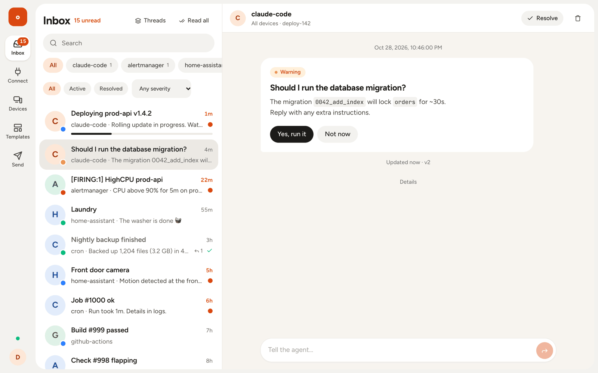
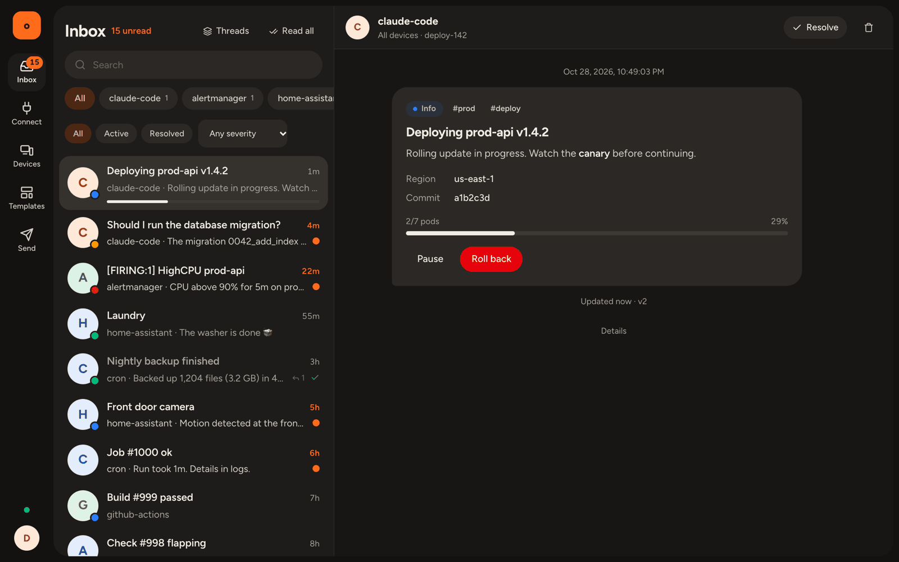
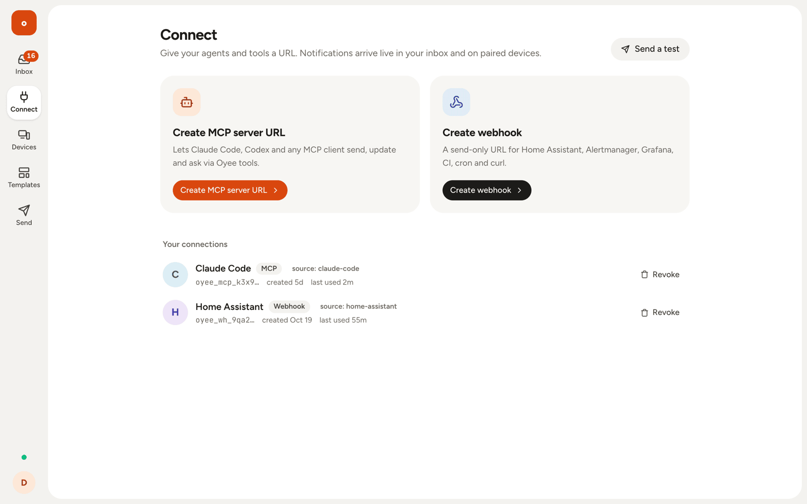
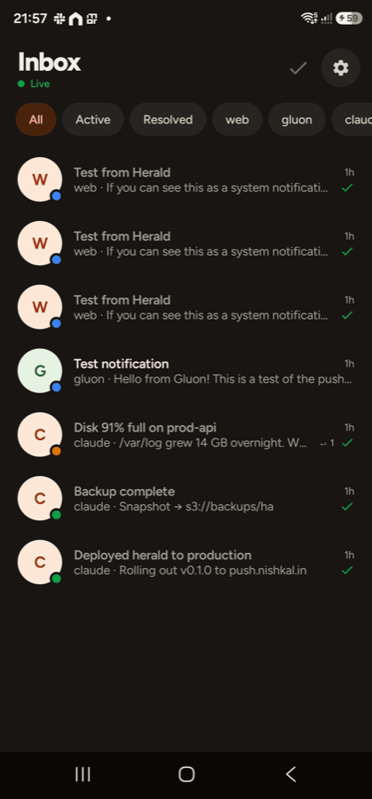
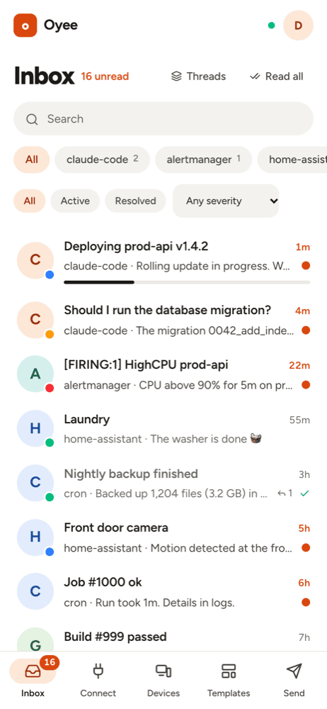

# Hark

**One inbox for AI agents, scripts and webhooks.** Send a notification with one HTTP call or one MCP tool call, and
receive it on Android, macOS and the web, with live-updating progress, action buttons, inline replies and sync across
devices.

[正體中文說明](README.zh-Hant.md) · [Run your own instance](docs/setup.md) · [Protocol](docs/protocol.md)



- 🤖 **MCP server URL**: give Claude Code, Codex or any MCP client `send_notification`, `update_notification`, `ask`,
  `wait_for_response` and more. Target one device (`devices: ["macbook"]`) or all of them.
- 🪝 **Webhooks**: paste a URL into Home Assistant, Alertmanager, Grafana, AWS SNS, GitHub Actions, cron or curl.
- 🔄 **Live notifications** that update in place (progress, status), resolve everywhere, and record your answers.
- 💬 **Two-way**: agents ask, you tap a button or type a reply on any device, and the agent gets the answer.
- 🧩 **Templates**: one platform-neutral card schema, rendered natively everywhere.

Free and open source (MIT).

## Screenshots

| Web (dark) | macOS |
|---|---|
|  |  |

| Connect an agent or webhook | Android | Web on a phone |
|---|---|---|
|  |  |  |

## Get it

| Platform | How |
|---|---|
| **Web** | Self-hosted: the worker serves the SPA at your own domain. Nothing to install — sign in with the shared password (or Google, if enabled) |
| **Android** (8.0+) | `./gradlew assembleDebug` in `apps/android`, or the `Hark-x.y.z.apk` artifact from [Releases](../../releases/latest). Allow *Install unknown apps* when asked |
| **macOS** (14+, Apple Silicon and Intel) | `pnpm macos:build`, or the `Hark-x.y.z-macOS.zip` artifact from [Releases](../../releases/latest). Not notarized: the first time, **right-click → Open** (or `xattr -dr com.apple.quarantine /Applications/Hark.app`) |
| **iOS** | Build from source ([docs/setup.md](docs/setup.md)). iOS can't be distributed without a paid Apple account |

Then pair the device: on the web, **Devices → Pair a device**, and enter the code in the app. Releases are built and
signed by GitHub Actions ([release.yml](.github/workflows/release.yml)); each one includes `SHA256SUMS.txt`.

## Quick start

1. Run an instance ([docs/setup.md](docs/setup.md)) and sign in at `https://<your-host>`.
2. On **Connect**, create an MCP server URL for your agent or a webhook for everything else.
3. Send something:

```bash
# Webhook
curl -d "Backup finished" "https://<your-host>/hook/<webhook-token>?title=Backup&severity=success"

# Claude Code
claude mcp add --transport http hark https://<your-host>/mcp/<mcp-token>
```

`https://<your-host>` is the deployment's `PUBLIC_URL`. This repository uses `hark.app` as a **placeholder**; replace it
in `apps/server/wrangler.jsonc` (`PUBLIC_URL`, `VAPID_SUBJECT`, `routes`) before deploying, and optionally as the default
server URL in `apps/android/app/build.gradle.kts` (`-PharkServerUrl=…`) and
`apps/apple/Sources/HarkKit/Support/Pairing.swift`.

## Docs

| | |
|---|---|
| [docs/setup.md](docs/setup.md) | Run your own instance: Cloudflare, sign-in (Google or a shared password), Firebase, web, Android, macOS |
| [docs/protocol.md](docs/protocol.md) | The API contract: REST, WebSocket, webhooks, MCP tools, push payloads |
| [docs/design.md](docs/design.md) | Design language (shared by web, macOS and Android) |
| [PLAN.md](PLAN.md) | Product plan, decisions and status |
| [README.zh-Hant.md](README.zh-Hant.md) | 正體中文說明 |

## Repository

| Path | What |
|---|---|
| `packages/schema` | Shared TypeScript types + zod schemas (protocol source of truth) |
| `apps/server` | Cloudflare Worker: API, MCP, webhooks, Durable Objects, D1 (Drizzle), push fan-out |
| `apps/web` | React web app (served by the worker) |
| `apps/android` | Android app (Kotlin, Compose) |
| `apps/apple` | macOS menu-bar app + iOS app (SwiftUI) + HarkKit |

## Develop

```bash
pnpm install
pnpm dev          # wrangler dev + vite
pnpm test
pnpm android:build
pnpm macos:build
```

**Releasing:** `git tag v0.2.0 && git push origin v0.2.0` builds the signed APK and the universal macOS app and
publishes them on GitHub Releases.

## Notes for self-hosters

- **Sign-in** is a shared password by default (`AUTH_MODE=password`): set `AUTH_PASSWORD_HASH` with
  `pnpm --filter @hark/server hash-password '<password>'`. Switch to `google` or `both` to keep Google sign-in.
- **Firebase is optional.** No `apps/android/app/google-services.json` is committed, so `assembleDebug` builds an app
  that uses the WebSocket transport. Create your own Firebase project (package name `app.hark.android`), drop its
  `google-services.json` in, and set the server's `FCM_SERVICE_ACCOUNT_JSON` from the same project to enable FCM.
- **Renamed from [Oyee](https://github.com/nishkalkashyap/oyee).** Hark is a rebrand of that MIT-licensed project:
  package names (`@hark/*`), Durable Object headers (`X-Hark-*`), token prefixes (`hark_wh_`, `hark_mcp_`, `hark_dev_`),
  the `hark_session` cookie and the `hark://` URL scheme all use the new name. Devices paired with an older build need
  to be paired again, and a renamed Worker starts without the old one's secrets and D1 data.